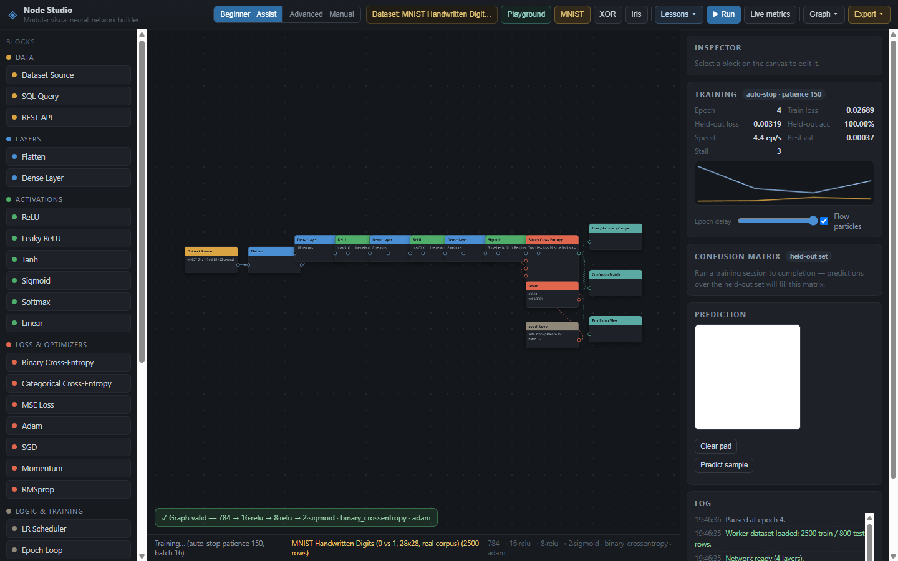

# Node Studio

**A Scratch-style visual neural-network builder with a real engine, real data and zero mocks.**

[](https://github.com/GaiDevOfficial/neural-network-studio/actions/workflows/ci.yml)
[](https://github.com/GaiDevOfficial/neural-network-studio/releases/latest)
[](LICENSE)

Node Studio is the whole application. Wire a model from draggable blocks on an infinite canvas, train it
through a dedicated worker, inspect the real metrics, correct it with your own drawings, and export it as
Python, JavaScript, NumPy or ONNX. The old forms-and-charts landing page is gone; the desktop launcher
opens `graph_studio.html` directly.

> Every loss, accuracy, confidence, gradient, confusion-matrix cell and wire pulse is produced by a real
> forward or backward pass through the production engine. There are no placeholder metrics, no simulated
> "AI is thinking" effects and no mocked test assertions.



---

## Download

The public Windows build is the portable one-folder app:

1. Download `NeuralNetworkStudio-Windows-x64.zip` from the [latest release](https://github.com/GaiDevOfficial/neural-network-studio/releases/latest).
2. Verify it against the published SHA-256.
3. Extract the folder and run `NeuralNetworkStudio\NeuralNetworkStudio.exe`.

No Python, Node.js, installer or external runtime is required. Keep the `_internal` folder beside the
launcher. The ZIP is built from the `dist/NeuralNetworkStudio` folder, not the developer-only one-file
bootloader that Windows Defender falsely flags.

---

## What is inside

### Three tiers, one engine

| Tier | Best for | Behaviour |
|---|---|---|
| **Absolute Beginner Playground** | First contact | A pre-built MNIST 0-vs-1 brain. Draw, ask, and correct it with real online backpropagation. |
| **Beginner - Assist** | Learning to wire | Smart Assist auto-wires, repairs, suggests the next legal block and snaps with real compiler checks. |
| **Advanced - Manual** | Full control | Raw sockets, strict validation and no automatic wiring. |

Switching tier never changes the engine, the worker protocol or the dataset contract.

### Canvas and block builder

- Infinite pan/zoom canvas with draggable blocks and bezier wires.
- Real block registry: data sources, Dense layers, activations, losses, optimizers, training loop,
  gauges, monitors and prediction probes.
- Shape inference and live compilation after every edit.
- Right-click a wire to **Break connection**, with an animated collapse and one undo entry.
- Drag a socket into empty space to open a cursor-anchored quick-add menu that lists only compatible
  blocks, ranked by actually compiling the candidate graph.
- Drag a block over the palette to delete it and sever every attached wire.
- Persistent undo history and an action journal that drives the lessons and missions.

### Real training and inspection

- Run / Pause / Reset through the shared Web Worker.
- Live epoch, training loss, held-out loss, accuracy, best epoch, convergence-stall readout and a loss
  sparkline.
- Held-out confusion matrix with per-class counts.
- Prediction probe: a drawing pad for image models and per-feature sliders for tabular models.
- GPU-free, dependency-free JavaScript engine with a NumPy parity suite.

### Data sources

- Built-in benchmarks: XOR, Concentric Circles, Two Moons, Two Spirals, Iris and Non-linear Regression.
- The real MNIST 0-vs-1 corpus, verified by digest and split from the original train/test partition.
- CSV upload with delimiter detection, header parsing, one-hot encoding and min-max normalization.
- SQLite queries, local CSV paths and REST/JSON endpoints through the bundled read-only Data API.
- A Class Filter block for remapping one-hot targets.

### Exports

- Graph JSON (layout, parameters and wires).
- Model JSON (architecture and learned weights).
- Standalone Python / NumPy inference script.
- Standalone JavaScript ES module.
- NumPy `.npz` weight archive.
- Dependency-free ONNX inference graph (opset 13, IR 8), verified with `onnxruntime`.
- Exact local build/run commands.

### Guided lessons and missions

Ten numbered lessons cover the Playground, presets, block building, backpropagation, manual wiring, SQL
streaming, three build-from-scratch missions and export/deploy. The missions start from a blank canvas
(13, 14 and 18 steps) and advance only after the real action. Highlights follow nodes through drag, pan,
zoom, scroll and layout changes; cards never cover the target.

### Honest deferrals

- **Conv2D**, **MaxPool** and **Dropout** are visible in the palette as *Planned* and disabled. The shipped
  engine is a Dense-stack engine.
- **Parquet** and folder loaders are not implemented.
- SQLite, local CSV-path and REST blocks require the local Python Data API; they are unavailable on a
  plain static host.

---

## Quick start from source

### Browser

```powershell
python server.py
# open http://127.0.0.1:8080/graph_studio.html
```

`/` and `/index.html` redirect to the Node Studio page. Use the local server rather than opening the
HTML file directly: browsers block the MNIST `fetch()` payload on `file://`.

### Portable Windows build

```powershell
python desktop/build_exe.py
```

This produces:

```text
dist/NeuralNetworkStudio/NeuralNetworkStudio.exe
dist/NeuralNetworkStudio-Windows-x64.zip
dist/NeuralNetworkStudio-Windows-x64.sha256.txt
dist/web/                       # static hosting bundle
```

`python desktop/build_exe.py --onefile` is developer-only. Do not distribute that artifact.

### Static hosting

Deploy `dist/web/` to Netlify, Vercel, GitHub Pages or any static host. Built-in datasets work with no
backend; the Data API blocks need `server.py` or the desktop app.

---

## Verification

```powershell
npm test                  # JavaScript suites + deterministic example-project certificate
npm run test:python       # reference engine, active learning, data connectors, desktop host
python tools/smoke_node_studio.py   # 108-check real-WebView2 UI smoke
npm run smoke:desktop     # desktop host reaches the Node Studio ready state
npm run smoke:packaged    # packaged launcher reaches Ready through WebView2 CDP
```

Current measured status:

- All JavaScript suites pass: graph, node convergence, DB streaming, exports, ONNX, DOM contract,
  menus, drag-to-delete, Playground, wire interactions, quick-add, missions and the 10-project
  certificate.
- All Python suites pass: reference engine, active learning, data connectors and the desktop host.
- The real-WebView2 UI smoke passes **108/108** checks.
- The packaged launcher reaches `Ready - build a graph or load a preset.` with **27** palette blocks
  and zero failed module requests.
- A Microsoft Defender custom scan of the portable folder and ZIP reports **no threats**. The app is
  unsigned, so SmartScreen may still show a first-run reputation warning on another machine; trusted
  code signing is the only way to remove that warning universally.

The tests are not decoration. They drive the real engine, the real worker RPC path, the real Data API and
the real browser DOM. See [NODE_STUDIO.md](NODE_STUDIO.md) for the full architecture and verification
record.

---

## Project layout

```text
.
├── src/
│   ├── graph_studio.html          # Node Studio page
│   ├── index.html                 # redirect shim for static hosts
│   ├── css/node_studio.css
│   ├── graph/                     # block registry, graph state, compiler, Smart Assist
│   ├── canvas/                    # palette, wire interactions, quick-add menu
│   ├── modes/                     # Playground, Assist/Manual policies
│   ├── tutorial/                  # lessons, missions, explanation catalogue
│   ├── ui/                        # canvas application, menus, action bar, guides
│   ├── engine/                    # JavaScript neural-network engine and Web Worker
│   ├── visualization/             # Playground synaptic renderer
│   ├── export/                    # Python/JS/NPZ/ONNX artifact builders
│   └── data/mnist_01/             # shipped MNIST 0-vs-1 payload
├── desktop/
│   ├── desktop_app.py             # PyWebView host + local HTTP server
│   ├── studio_data_api.py         # read-only SQLite/CSV/REST Data API
│   └── build_exe.py               # portable build + ZIP + checksum
├── python_core/                   # NumPy reference engine and active-learning tests
├── tests/                         # JavaScript and desktop-host suites
├── tools/                         # smokes, ONNX parity, example certificate, release scripts
├── projects/                      # starter CSV datasets
├── example_projects.md
├── NODE_STUDIO.md
├── tutorial.md
└── README.md
```

---

## Releases and backups

Releases follow semantic versioning and are published from annotated Git tags. Each release includes the
portable ZIP, its SHA-256 and release notes. The `backup` branch always points at the previous released
commit, and `backups/` keeps a local ZIP of that previous version.

To publish a change with the repository workflow:

```powershell
powershell -ExecutionPolicy Bypass -File tools/push_with_backup.ps1 -Message "Describe the change"
```

The script commits, bumps the patch version, tags it, updates the one-version-behind backup branch,
pushes `main` + `backup` + tags and creates the GitHub release with the build assets. See
[CONTRIBUTING.md](CONTRIBUTING.md) for the manual equivalent.

---

## License and brand

Node Studio is **open source under AGPL-3.0-or-later**. You can use, study, modify and share it. If you
distribute a modified version, or run one as a network service, the AGPL requires you to offer the
corresponding source under the same license. That copyleft is the practical protection against a company
taking the code, making a proprietary derivative and hiding the changes.

The **Node Studio name, logo and visual identity are trademarks** and are not granted by the code license.
Forks must use a different name and branding.

Organizations that need proprietary redistribution, a hosted service without the AGPL network-source
obligation, or written support terms can obtain a separate commercial license.

- [LICENSE](LICENSE) - full AGPL-3.0 text.
- [LICENSING.md](LICENSING.md) - what the license does and does not protect.
- [COMMERCIAL.md](COMMERCIAL.md) - commercial licensing.
- [TRADEMARKS.md](TRADEMARKS.md) - brand policy.

No license can prevent an independent team from reimplementing an abstract idea. AGPL protects this
specific implementation, its source and its derivatives; the trademark policy protects the project's
identity.
